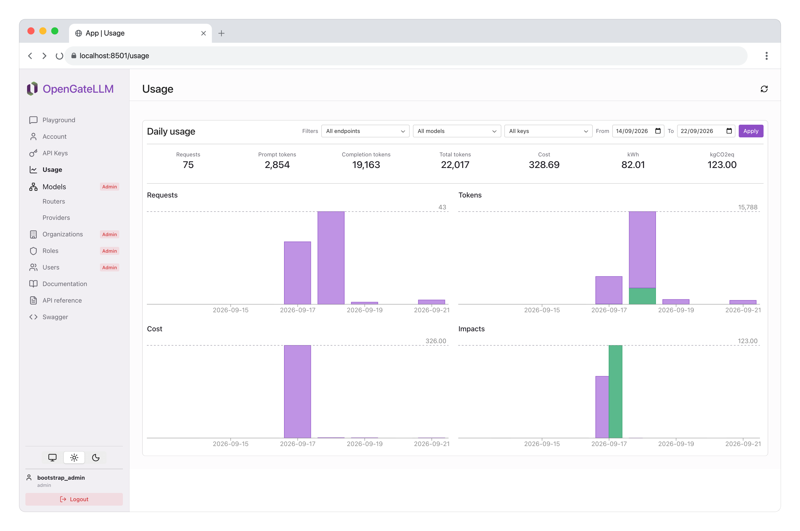

import { Aside, LinkButton } from '@astrojs/starlight/components';

## Request usage logging

OpenGateLLM records usage for each model-forward API request (chat completions, embeddings, OCR, rerank, audio transcriptions). This helps you analyze consumption over time, identify patterns, and support reporting.

Usage is recorded in the PostgreSQL `usage` table, for successful requests only: a failed request consumed nothing. `GET /v1/usage` (and the Playground *Usage* page) reads from this table.

When the [Langfuse dependency](/configuration/dependencies/langfuse/) is configured, every model-forward request is also traced in Langfuse, failures included.

Sensitive information such as the prompt or response content is not included in the logs.

The usage table contains the following information:
- user ID
- router ID
- provider ID
- number of prompt tokens
- number of completion tokens
- environmental footprint (see the dedicated documentation [here](/features/usage/environmental_footprint/))
- cost (see the dedicated documentation [here](/features/usage/budget/))

User can see their usage in the *Usage* page of the Playground.

### Token counts

The token counts come from the provider when its response has a `usage` field. Otherwise, OpenGateLLM counts the prompt and the completion with the tokenizer of the router: the `tokenizer` of the model (a `tiktoken_*` encoding, a Hugging Face id or the path of a `tokenizer.json`). A router without `tokenizer` uses the deprecated `usage_tokenizer` of the `settings` section (default `tiktoken_gpt2`, a generic tiktoken encoding). Audio transcriptions are always counted with this tokenizer.

For a streamed chat completion, OpenGateLLM asks the provider for a final usage chunk and keeps the last `usage` it sends. A stream cut before its end is counted with the tokenizer on the text already delivered.

When the provider served part of the prompt from its cache, it reports those tokens in `usage.prompt_tokens_details.cached_tokens`. OpenGateLLM returns them in the response, and they are already included in `prompt_tokens`:

```json
"usage": {
  "prompt_tokens": 1000,
  "completion_tokens": 200,
  "total_tokens": 1200,
  "prompt_tokens_details": {"cached_tokens": 800},
  ...
}
```

The cached tokens are not stored in the usage table, so `GET /v1/usage` and the *Usage* page only show `prompt_tokens`, cached ones included. When Langfuse is configured, each trace splits them: `input` holds the prompt tokens not cached and `input_cached_tokens` the cached ones. Cached tokens are partly deducted from rate limits, see [Rate limiting](/features/usage/rate_limiting/#token-counts).



## Real-time metrics

In addition to the usage data stored in PostgreSQL, OpenGateLLM can expose real-time inference metrics (request rate, request duration, time to first token, token consumption and output generation speed) in Prometheus format on the `/metrics` endpoint.

Ready-to-use Grafana dashboards built on these metrics are available in the [`grafana/`](https://github.com/etalab-ia/OpenGateLLM/tree/main/grafana) folder of the repository. See the [Prometheus documentation](/configuration/dependencies/prometheus/) for the list of exposed metrics, the dashboards and the configuration.

<LinkButton href="/configuration/dependencies/prometheus/" icon="external">Prometheus documentation</LinkButton>

## Model health monitoring

OpenGateLLM provides a health check endpoint to monitor the health of the models. This endpoint is available at `/health/models` and returns a JSON response with the health status of the models.

```json
{
  "data": [
    {
      "id": "model_name",
      "status": "green" | "yellow" | "red"
    }
  ]
}
```


The endpoint requires authentication. It only returns models (routers) the calling user is allowed to access.

### How status is computed

Health is evaluated **per model** (router). Each provider of the model gets a status from two inputs:

- **Liveness**: OpenGateLLM calls the provider's `/v1/models`, with a 4-second timeout. The provider is live if it answers, even with a payload OpenGateLLM cannot parse.
- **Load**: the number of requests the gateway is forwarding to the provider right now, compared to its `qos_limit`. See [Load](/features/usage/load/) to choose that limit.

| Condition | Provider status |
| --- | --- |
| Not live, or `qos_limit` is `0` (closed) | `red` |
| Load reaches `qos_limit` | `red` |
| Load reaches 95% of `qos_limit` | `yellow` |
| Otherwise, including `qos_limit: null` | `green` |

The model status is the **best** status among its providers (`green` > `yellow` > `red`): the gateway keeps sending requests to the providers that can take them, so a model stays available as long as one of them can.

`red` means the load reached the capacity chosen for the provider. Whether the gateway then refuses the request depends on the router's `qos_retries_before_reject`: with `null`, positive limits are not enforced and the request is still forwarded.

When Redis is unreachable, the load cannot be read and the gateway forwards without limits: the status then only reflects liveness and closed providers.
